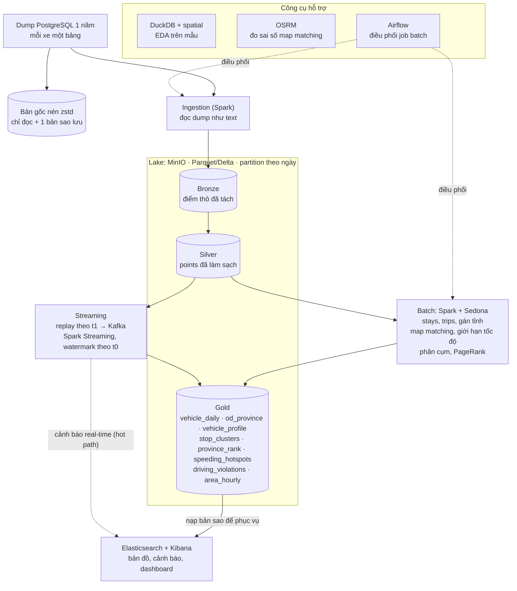

# Đồ án Dữ liệu lớn – Pipeline dữ liệu GPS xe tải toàn quốc

**Phiên bản:** cập nhật 29/10/2026 (nhóm 3 người)
**Thành viên:** Bách Hợp · Nguyễn Thành Đạt · Thảo Trang

> Mọi chỗ ghi **[CẦN XÁC NHẬN]** là giả định, nhóm kiểm tra lại trước khi làm.

---

## 1. Mục tiêu

Xây dựng nền tảng dữ liệu lớn xử lý dữ liệu GPS xe tải trên cả nước (xe nội tỉnh và liên tỉnh) để trả lời:

| Mã | Câu hỏi |
|---|---|
| RQ1 | Phân loại xe theo hành vi di chuyển (nội tỉnh, liên tỉnh, tuyến cố định, đường dài…) |
| RQ2 | Kho bãi, điểm giao hàng, điểm dừng nghỉ nằm ở đâu |
| RQ3 | Dòng hàng giữa các tỉnh; tỉnh nào là đầu mối logistics |
| RQ4 | Vượt tốc độ và lái xe liên tục quá giờ: ở đâu, khi nào, nhóm xe nào |
| RQ5 | Hệ thống chịu tải bao nhiêu; cách phân vùng nào xử lý tốt dữ liệu lệch giữa các tỉnh |

---

## 2. Dữ liệu nguồn

**Định dạng:** file dump PostgreSQL (`.sql`), mỗi xe là một bảng, mỗi dòng là 1 xe × 1 giờ.

| Cột bảng gốc | Ý nghĩa |
|---|---|
| `VehicleCode` | Mã xe |
| `Date` | `yyyymmddhh`, ví dụ `2026101100` = 11/10/2026, 00 giờ |
| `Details` | Mảng JSON các điểm GPS trong giờ đó |
| `Total` | Số điểm trong giờ |
| `CreatedTime` | Thời điểm tạo dòng |

**Trường trong mỗi điểm GPS (`Details`):**

| Trường | Ý nghĩa (suy đoán) | Ghi chú |
|---|---|---|
| `t0` | Thời điểm thiết bị lấy vị trí (event time) | Hay bị lặp giữa 2 bản ghi liên tiếp |
| `t1` | Thời điểm server nhận | Chậm hơn `t0` vài giây đến ~2 phút |
| `lt`, `ln` | Vĩ độ, kinh độ | |
| `vl` | Vận tốc | **[CẦN XÁC NHẬN]** đơn vị |
| `st` | Trạng thái | **[CẦN XÁC NHẬN]** bảng mã |
| `ag` | Hướng (độ, 0–359) | |
| `km` | Odometer cộng dồn | Không reset theo chuyến |
| `de` | Mã xe | |
| `cb` | Tên tiến trình xử lý phía server | Chứa biển số khác, **không dùng làm mã xe** |

**Lưu ý quan trọng:**
- **Không chạy thẳng file dump vào PostgreSQL**: dòng đầu có `DROP DATABASE gps;`. File còn dùng lệnh `\restrict` của psql 17, bản cũ sẽ lỗi.
- **Không có địa chỉ / tỉnh** → phải tự gán tỉnh bằng bản đồ ranh giới (đơn vị hành chính sau sắp xếp 2025).
- **Không có tải trọng xe** → bài vượt tốc độ phải giả định loại xe.
- Xe đỗ vẫn gửi ~1 điểm/phút → phần lớn dung lượng có thể là điểm đứng yên.
- **[CẦN XÁC NHẬN]** múi giờ của `t0`, `t1` (giờ Việt Nam hay UTC).

---

## 3. Kiến trúc

### Công cụ

| Vai trò | Công cụ | Ghi chú |
|---|---|---|
| Lưu trữ | Parquet / Delta Lake trên MinIO (Bronze, Silver, Gold) | Hoặc HDFS nếu xin được cụm HPC Lab. Elasticsearch chỉ giữ bản sao Gold để phục vụ dashboard |
| Xử lý | PySpark 3.5 + Apache Sedona | |
| Hàng đợi | Kafka (KRaft) + Kafka UI | |
| EDA | DuckDB + extension `spatial` | Đọc thẳng Parquet, không cần cloud |
| Map matching | OSRM (Docker) | Dữ liệu OSM Việt Nam từ Geofabrik |
| Dashboard | Elasticsearch + Kibana | |
| Điều phối | Airflow (`LocalExecutor`) | |
| Hạ tầng | Docker Compose | |

**Chi phí:** 0 đồng (có thể phát sinh 1 ổ cứng ngoài nếu thiếu chỗ chứa bản gốc).

---

## 4. Quy ước chung (chốt trước khi code)

| Quy ước | Nội dung |
|---|---|
| Đường dẫn | `s3a://gps/{bronze,silver,gold,ref,quarantine}/<bảng>/date=YYYY-MM-DD/` |
| Partition | Theo ngày; trong mỗi partition sắp xếp theo `(vehicle_key, gps_time)` |
| Kích thước file | 128 MB – 1 GB; nếu mỗi ngày quá nhỏ thì partition theo tháng |
| Job Spark | Nhận tham số `--date`, chỉ ghi đè đúng partition ngày đó (chạy lại không tạo trùng) |
| Ẩn danh | Mã xe → `vehicle_key` (int); bảng ánh xạ chỉ để ở máy chứa dữ liệu gốc |
| Dòng lỗi | Ghi vào `quarantine/`, không bỏ im lặng |
| Dữ liệu mẫu chung | Mẫu 1 ngày (để code) và mẫu 1 tháng (để EDA), cùng schema Silver |
| Repo Git | `infra/`, `jobs/ingest/`, `jobs/batch/`, `jobs/streaming/`, `dags/`, `notebooks/`, `docs/` |

---

## 5. Schema

### 5.1 Silver

**`silver.points`** – 1 dòng = 1 điểm GPS đã làm sạch

| Cột | Kiểu | Ghi chú |
|---|---|---|
| `vehicle_key` | bigint | `xxhash64(VEHICLE_KEY_SALT, mã xe)` – ẩn danh |
| `date` | date | partition |
| `gps_time` | timestamp | từ `t0` |
| `recv_time` | timestamp | từ `t1`, lấy lần nhận sớm nhất khi trùng `t0` |
| `lat`, `lon` | double | đã lọc ngoài khung Việt Nam |
| `speed` | double | từ `vl` |
| `odometer` | double | từ `km` |
| `status` | int | từ `st` |
| `heading` | int | từ `ag` |
| `clock_fixed` | boolean | `true` nếu `gps_time` đã thay bằng `t1` do giờ thiết bị sai |

**`silver.stays`** – 1 dòng = 1 đoạn xe đứng yên

`vehicle_key, stay_id, date, start_time, end_time, duration_s, lat, lon, n_points, province`

**`silver.trips`** – 1 dòng = 1 chuyến

`vehicle_key, trip_id, date, start_time, end_time, start_lat, start_lon, end_lat, end_lon, start_province, end_province, distance_odo_km, distance_gps_km, moving_time_s, max_speed`

### 5.2 Ref

**`ref.roads`** – đoạn đường OSM

`road_id, highway, maxspeed, maxspeed_hgv, speed_limit, limit_source (osm_hgv / osm / default), geometry_wkt, bearing`

**`ref.provinces`** – ranh giới tỉnh (sau sắp xếp 2025)

**`ref.h3_speed_limit`** – ô H3 → giới hạn tốc độ (dùng cho streaming)

### 5.3 Gold

| Bảng | Cột chính | Phụ trách |
|---|---|---|
| `driving_violations` | `vehicle_key, type (speeding / continuous_driving), start_time, end_time, duration_s, max_speed, speed_limit, max_excess, road_id, province` | Đạt (vượt tốc độ), Bách Hợp (lái liên tục) |
| `speeding_hotspots` | `road_id / h3_cell, hour, n_events, n_vehicles` | Đạt |
| `area_hourly` | `province / h3_cell, hour, avg_speed, n_active_vehicles` | Bách Hợp |
| `vehicle_profile` | `vehicle_key, n_provinces_week, radius_km, km_per_day, max_trip_km, night_ratio, stops_per_day, cluster_label` | Chưa phân công (giai đoạn sau) |
| `stop_clusters` | `cluster_id, lat, lon, stop_type, n_visits, n_vehicles` | Chưa phân công (giai đoạn sau) |
| `province_rank` | `province, pagerank, community_id` | Chưa phân công (giai đoạn sau) |
| `vehicle_daily` | `vehicle_key, date, km, driving_time_s, stop_time_s, max_speed, n_speeding, n_provinces` | Thảo Trang |
| `od_province` | `origin, destination, week, n_trips` | Thảo Trang |
| `pipeline_metrics` | `run_id, component, input_rows_per_s, processed_rows_per_s, latency_s, kafka_lag, n_executors, n_partitions` | Cả nhóm |

---

## 6. Phân công

### Giai đoạn 1 (27/10 – 8/11)

**Mục tiêu:** đến 8/11, hệ thống chạy thử được từ đầu đến cuối với dữ liệu của 1 ngày: đưa dữ liệu vào → làm sạch → tổng hợp → hiện lên dashboard.

| Người | Đến 30/10 | Đến 3/11 | Đến 7/11 |
|---|---|---|---|
| **Bách Hợp** – dữ liệu, bản đồ | Xin bên cung cấp 1 tuần dữ liệu (50–100 xe), giữ đúng định dạng dump | Cài OSRM (Docker, OSM Việt Nam) | `ref.roads` (đường + giới hạn tốc độ); chọn máy chung cho cả nhóm |
| **Đạt** – đưa dữ liệu vào | Đọc file dump thật → Bronze | Làm sạch → Silver; bắt đầu script dữ liệu giả lập | Giả lập 10 xe × 1 ngày chạy qua hệ thống; gửi bộ mẫu cho nhóm |
| **Thảo Trang** – kết quả, dashboard | Chốt các bảng dữ liệu (`docs/schema.md`) | Bảng Gold `vehicle_daily` | Đưa Gold lên Kibana, dashboard đơn giản |

**Mốc chung:**
- 30/10: chốt các bảng dữ liệu
- 4/11: chưa có dữ liệu thật → báo giảng viên, dùng dữ liệu giả lập làm nguồn chính
- 8/11: ghép nối, chạy thử từ đầu đến cuối, họp tổng kết
- Chủ nhật nào cũng họp ngắn 15–20 phút

### Giai đoạn sau (dự kiến, chốt lại khi có hạn nộp)

| Người | Mảng phụ trách |
|---|---|
| **Bách Hợp** | Hạ tầng chung, Airflow; streaming (replay vào Kafka, Spark Streaming, cảnh báo lái liên tục); đo hiệu năng |
| **Đạt** | Ingestion toàn bộ dữ liệu; vượt tốc độ (map matching, phát hiện vi phạm, so sánh OSRM, bảng tra cho streaming) |
| **Thảo Trang** | Gold, đẩy lên Elasticsearch, dashboard Kibana; EDA; tổng hợp báo cáo, slide |
| *Chưa phân công* | Stays/trips, phân cụm, PageRank – chia lại sau giai đoạn 1 |

**Phân chia việc với Kafka:** Hạ tầng lo Kafka chạy được và quan sát được (container, topic, partition, retention, Kafka UI). Streaming lo dữ liệu vào/ra (producer, Spark Streaming).

---

## 7. Checklist EDA (Thảo Trang)

Mỗi mục ra một con số hoặc một biểu đồ:

1. Độ phủ: số xe, số ngày, số điểm mỗi xe mỗi ngày; xe thiếu dữ liệu nhiều ngày
2. Tần suất ghi: phân phối khoảng cách thời gian giữa 2 điểm, **tách riêng lúc xe chạy và lúc đứng yên**
3. Độ trễ `t1 − t0` và tỉ lệ bản ghi trùng `t0`
4. Tỉ lệ điểm đứng yên
5. Phân phối vận tốc, giá trị bất thường (> 150 km/h, âm)
6. Tọa độ ngoài Việt Nam hoặc (0, 0)
7. Các giá trị của `st` và liên hệ với vận tốc
8. Odometer so với quãng đường tính bằng haversine

---

## 8. Bài toán vượt tốc độ

1. **Định nghĩa vi phạm:** chuỗi điểm liên tiếp có `speed > giới hạn + dung sai` (dự kiến 5 km/h), kéo dài ≥ 30–60 giây, không có khoảng trống > 2 phút. **[CẦN XÁC NHẬN]** các ngưỡng.
2. **Mạng lưới đường:** OSM Việt Nam (Geofabrik) với `highway`, `maxspeed`, `maxspeed:hgv`. Vietmap chỉ dùng để kiểm chứng trên mẫu nếu hạn mức miễn phí nhỏ.
3. **Gán giới hạn:** `maxspeed:hgv` → `maxspeed` → mặc định theo loại đường và khu vực theo quy định hiện hành **[CẦN XÁC NHẬN văn bản đang hiệu lực]**. Vì không biết tải trọng: giả định xe tải > 3,5 tấn, hoặc tính 2 kịch bản.
4. **Map matching:**
   - Toàn bộ dữ liệu: đoạn đường gần nhất trong 20–30 m + hướng xe khớp hướng đường (Spark + Sedona).
   - Trên mẫu: OSRM làm "đáp án" để đo tỉ lệ gán sai của cách trên.
5. **Phát hiện sự kiện:** window function theo xe, kỹ thuật gaps-and-islands; cắt chuỗi khi 2 điểm cách nhau > 2 phút.
6. **Streaming:** dùng bảng tra ô H3 → giới hạn (broadcast), không chạy map matching đầy đủ.
7. **Giới hạn cần nêu trong báo cáo:** tần suất ghi thưa bỏ sót vi phạm ngắn; sai số GPS ở chỗ nhiều đường gần nhau; phần lớn giới hạn có thể là giá trị mặc định; chưa biết tải trọng xe.

---

## 9. Đánh giá hiệu năng

| Thí nghiệm | Biến thay đổi | Đo |
|---|---|---|
| Sức chịu tải streaming | Tốc độ replay tăng dần; executor 1 / 2 / 4; partition Kafka 3 / 6 / 12 | Bản ghi/giây vào và xử lý, Kafka lag, độ trễ end-to-end |
| Dữ liệu lệch | Partition theo tỉnh / theo xe / theo ô H3 | Thời gian chạy, task chậm nhất so với trung vị |
| Mở rộng batch | 1 tháng → 3 tháng → 1 năm | Thời gian chạy từng job |
| Nén dữ liệu | Dump → Parquet → sau khi nén điểm đứng yên | Dung lượng, số dòng |
| Map matching | Đoạn gần nhất + hướng vs OSRM | Tỉ lệ gán đúng, thời gian chạy |

---

## 10. Điểm quyết định ngày 17/10

Cả nhóm xem 3 con số này trước khi sang giai đoạn 2:

1. **Dung lượng và số xe thực tế** → chạy trên máy nhóm hay cần xin HPC Lab
2. **Tần suất ghi khi xe đang chạy** → nếu ~1 điểm/phút, bài vượt tốc độ chuyển trọng tâm sang "điểm nóng"
3. **Tỉ lệ độ phủ `maxspeed`** → nếu thấp, ghi rõ kết quả dựa phần lớn vào giới hạn mặc định

---

## 11. Câu hỏi cần hỏi bên cung cấp dữ liệu

- [ ] Ý nghĩa `t0`, `t1` và múi giờ
- [ ] Bảng mã `st`, đơn vị `vl`
- [ ] Có thông tin loại xe / tải trọng (dù chỉ một phần đội xe) không
- [ ] Có danh sách kho, khách hàng (đã ẩn danh) để kiểm chứng phân cụm không
- [ ] Được công bố kết quả ở mức nào, cần ẩn danh những trường nào

---

## 12. Góp ý

Mỗi người ghi góp ý ngay dưới mục liên quan, ghi tên ở đầu dòng, ví dụ:
`[Đạt] Mục 8.1: đề xuất dung sai 10 km/h vì ...`
